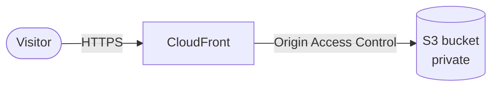

# Cloud Resume Challenge

My resume site, hosted on AWS with the infrastructure in Terraform.

**Live:** https://dldai41zkjod3.cloudfront.net

## Architecture

- **S3** stores the static files in a private bucket with Block Public Access enabled.
- **CloudFront** serves the site over HTTPS and redirects HTTP to HTTPS.
- **Origin Access Control** lets only this distribution read the bucket.
- **Terraform** defines everything in [`infra/`](infra/).

## Key decisions

- The bucket is never public. Its policy only trusts this CloudFront distribution.
- No long-lived access keys. The v1 deploy pipeline used one and was removed.
- Terraform state stays local and out of Git.
- Cost is effectively zero, within the CloudFront and S3 free tiers.

## Next steps

- Remote Terraform state in S3
- Custom domain with ACM and Route 53
- Deploy pipeline with GitHub Actions and OIDC

The v1 (2025) architecture is documented in [`docs/architecture/`](docs/architecture/).
