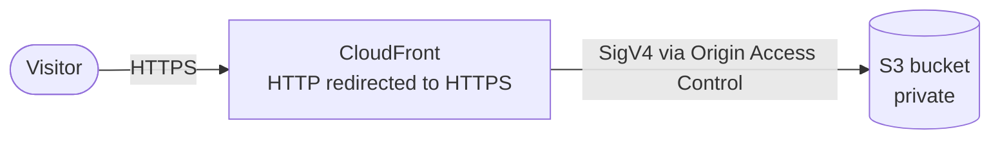

# Cloud Resume Challenge: static site on AWS

My resume site, hosted on AWS with the infrastructure defined in Terraform.

**Live site:** https://dldai41zkjod3.cloudfront.net

This is version 2 of the project. Version 1 (2025) was built by hand in the AWS console. Version 2 rebuilds the hosting as code, with a private bucket and a smaller, safer setup.

## Architecture



- **Amazon S3** stores the static files. The bucket is private, with Block Public Access fully enabled.
- **Amazon CloudFront** serves the site over HTTPS, redirects HTTP to HTTPS and compresses responses.
- **Origin Access Control (OAC)** lets only this CloudFront distribution read the bucket. The bucket policy checks the distribution ARN through an `AWS:SourceArn` condition.
- **Terraform** defines all of the above in [`infra/`](infra/).

More detail, including the v1 diagram, in [`docs/architecture/`](docs/architecture/).

## Repository layout

```
site/    HTML, CSS, JavaScript and images (the only folder uploaded to S3)
infra/   Terraform: S3 bucket, bucket policy, OAC and CloudFront distribution
docs/    Architecture diagrams
```

## Deploying

Requirements: Terraform 1.6 or later, AWS CLI v2 and AWS credentials in the environment (for example `AWS_PROFILE`).

**1. Provision the infrastructure**

```bash
cd infra
terraform init
terraform plan -out=tfplan
terraform apply tfplan
```

The outputs give the bucket name, the distribution ID and the site URL.

**2. Upload the site**

```bash
cd ..
aws s3 sync site/ "s3://$(terraform -chdir=infra output -raw bucket_name)" --delete --exclude "*.map"
aws cloudfront create-invalidation --distribution-id "$(terraform -chdir=infra output -raw distribution_id)" --paths "/*"
```

Only `site/` is synced, so nothing else in the repository is ever published.

**Tearing down**

```bash
aws s3 rm "s3://$(terraform -chdir=infra output -raw bucket_name)" --recursive
terraform -chdir=infra destroy
```

The bucket has to be emptied first because Terraform does not delete a bucket that still has objects.

## Design decisions

| Decision | Reason |
|---|---|
| Private bucket behind CloudFront with OAC | The bucket is never exposed. Static website hosting on a public bucket would also mean no HTTPS on the S3 endpoint. |
| `bucket_prefix` instead of a fixed bucket name | Bucket names are global. A prefix gets a unique name without hardcoding anything account specific in a public repository. |
| Default `cloudfront.net` certificate | The custom domain is not in use yet. A custom domain would need an ACM certificate in `us-east-1`. |
| `PriceClass_100` | Cheapest edge tier (North America and Europe). Visitors elsewhere are still served, from a farther edge. |
| AWS managed `CachingOptimized` cache policy | Suits static content and avoids maintaining a custom policy. |
| `default_tags` in the provider | Every resource gets `Project`, `ManagedBy` and `Repository` tags without repeating them. |
| Local Terraform state, gitignored | One maintainer and five resources. The state holds account details, so it must never be committed. |
| Manual deploy | The site changes rarely. The old pipeline used a long-lived IAM access key, which was removed. |

## Cost

Effectively zero at portfolio traffic levels:

- CloudFront: covered by the always free tier (1 TB of data transfer and 10 million requests per month).
- S3: a few MB of storage and a handful of requests, well under one cent per month.
- A monthly AWS Budget with email alerts guards against surprises.

## What changed from v1

| | v1 (2025) | v2 |
|---|---|---|
| Provisioning | AWS console, by hand | Terraform |
| Bucket access | Configured in the console, never captured in code | Private bucket, OAC with a `SourceArn` condition |
| Deploy | GitHub Actions with a static IAM access key, syncing the whole repository | Manual sync of `site/` only |
| Visitor counter | API Gateway, Lambda and DynamoDB | Removed. The API is being rebuilt as a separate Kubernetes project |
| Contact | Formspree form | Plain links (email, LinkedIn, GitHub) |
| Domain | `pedrobortolini.com.br` with ACM and Route 53 | CloudFront URL for now |

## Roadmap

- Remote Terraform state in S3 with native locking
- Custom domain with ACM and Route 53
- Deploy pipeline in GitHub Actions using OIDC instead of access keys
- Security response headers (HSTS, CSP) and a custom 404 page

## Known limitations

- A missing page returns `403` instead of `404`. The bucket policy grants only `s3:GetObject`, so S3 does not reveal whether an object exists. A custom error page is on the roadmap.
