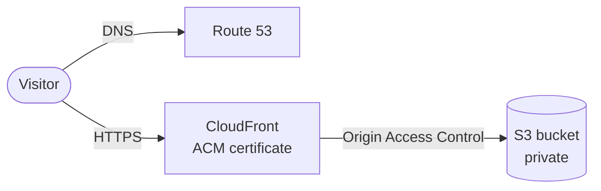

# Cloud Resume Challenge

My resume site, hosted on AWS with the infrastructure in Terraform.

**Live:** https://pedrobortolini.com.br

## Architecture

- **S3** stores the static files in a private bucket with Block Public Access enabled.
- **CloudFront** serves the site over HTTPS and redirects HTTP to HTTPS.
- **Origin Access Control** lets only this distribution read the bucket.
- **Route 53** hosts the DNS zone, with alias records for the apex and `www`. The domain is registered at Registro.br.
- **ACM** issues the TLS certificate, validated and renewed through DNS.
- **Terraform** defines everything in [`infra/`](infra/).

## Key decisions

- The bucket is never public. Its policy only trusts this CloudFront distribution.
- No long-lived access keys. The v1 deploy pipeline used one and was removed.
- Terraform state lives in a versioned, encrypted S3 bucket with native locking, created by [`infra/bootstrap/`](infra/bootstrap/).
- Cost is about $0.50/month for the hosted zone; CloudFront and S3 stay within the free tier.

## Next steps

- Deploy pipeline with GitHub Actions and OIDC

The v1 (2025) architecture is documented in [`docs/architecture/`](docs/architecture/).
