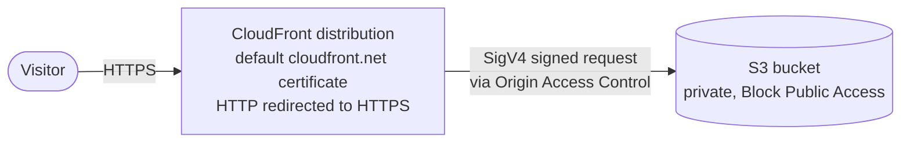
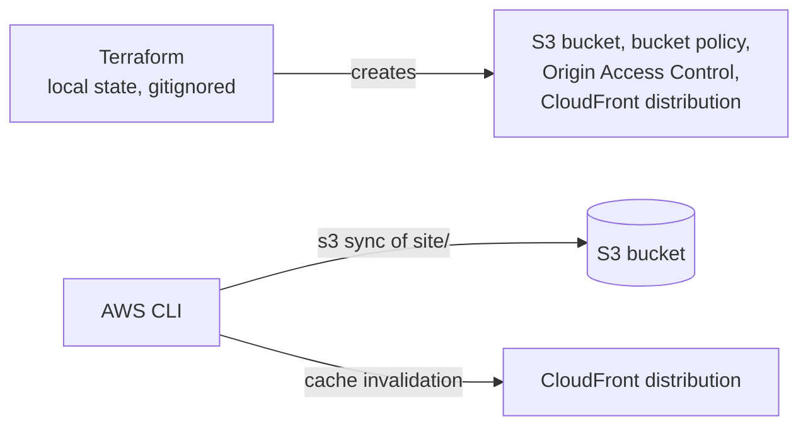

# Architecture

## Current architecture (v2)

A static site served from a private S3 bucket through CloudFront. All AWS resources are defined in Terraform (`infra/`). Deploys are run manually from a local machine.

### Request path

### Provisioning and deploy

Both run from a local machine.

Key points:

- The bucket is never public. Block Public Access is fully enabled, and the bucket policy allows `s3:GetObject` only to the CloudFront service principal, with an `AWS:SourceArn` condition that pins it to this one distribution.
- CloudFront signs every origin request with SigV4 through Origin Access Control (OAC), the successor of the legacy Origin Access Identity.
- Only the `site/` folder is uploaded, so repository files (`.git/`, `infra/`, Terraform state, docs) never reach the bucket.

## Previous architecture (v1)

The original version of this project used S3, CloudFront, Route 53 and ACM for the static site, plus API Gateway, Lambda and DynamoDB for the visitor counter.

All AWS resources from this version were later removed. The architecture below was reconstructed from the repository code and Git history.

