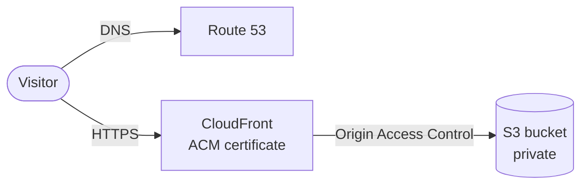

# Architecture

## v2 (current)

A private S3 bucket served through CloudFront on a custom domain, all defined in Terraform. The bucket policy allows reads only from this distribution.

## v1 (2025)

S3, CloudFront, Route 53 and ACM for the site, plus API Gateway, Lambda and DynamoDB for a visitor counter. The site was set up in the AWS console and the API with OpenTofu. All of it was later removed. Reconstructed from the code and Git history.

