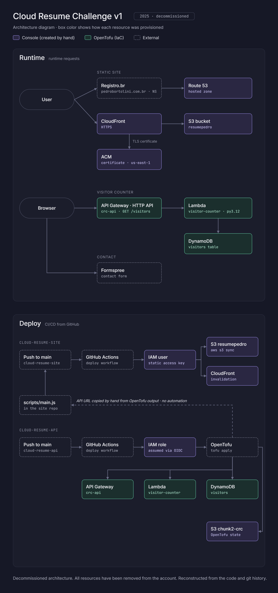

## Previous architecture (v1)

The original version of this project used S3, CloudFront, Route 53 and ACM for the static site, plus API Gateway, Lambda and DynamoDB for the visitor counter.

All AWS resources from this version were later removed. The architecture below was reconstructed from the repository code and Git history.

